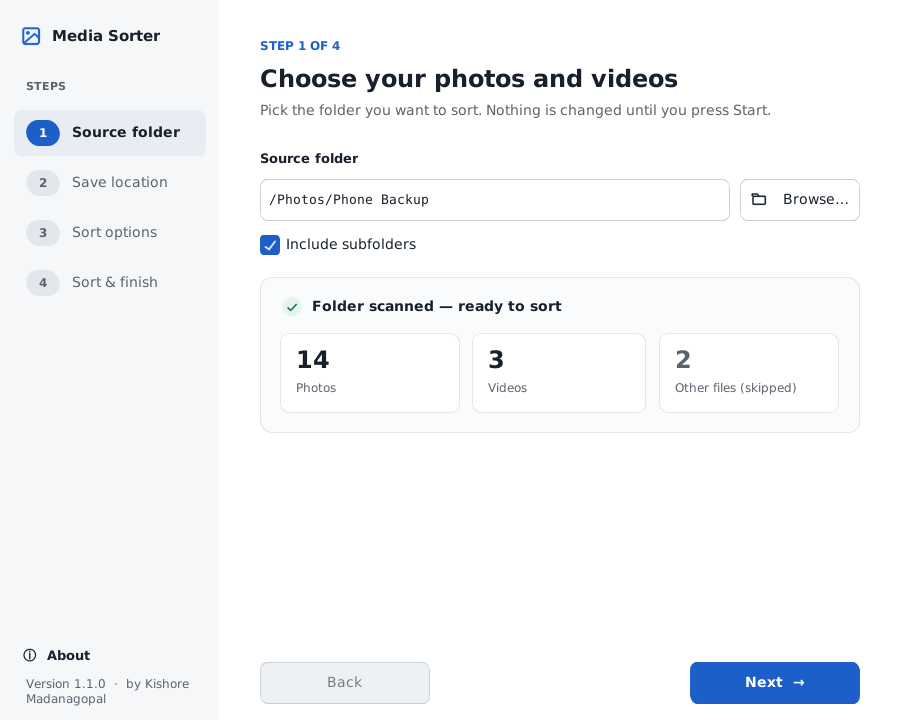
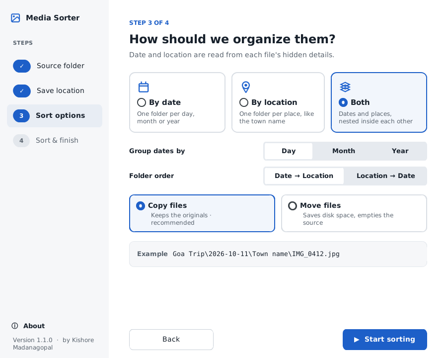
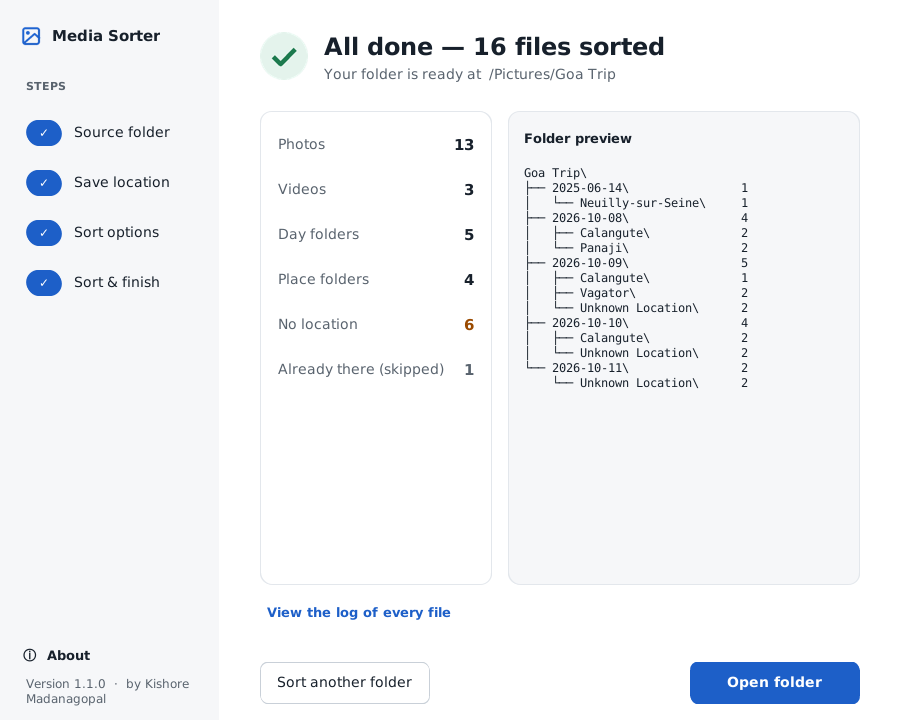

<p align="center">
  
</p>

<h1 align="center">Media Sorter</h1>

<p align="center">
  A free Windows app that sorts your photos and videos into folders by <b>day, month or year</b>, by <b>place</b>, or <b>both</b>.<br>
  Works offline. Never touches your originals.
</p>

<p align="center">
  <a href="https://github.com/kishoremadanagopal/media-sorter/releases/latest"><b>⬇ Download for Windows</b></a>
</p>

---

## Why

Phone backups end up as thousands of files named `IMG_0412.jpg`. Finding the photos from one trip means scrolling forever.
Media Sorter reads when and where each photo and video was taken, and files them for you:

```
Goa Trip\
├── 2026-10-08\
│   ├── Calangute\
│   └── Panaji\
└── 2026-10-09\
    ├── Anjuna\
    └── Unknown Location\
```

## Install

1. Download **MediaSorter-Setup** from the [latest release](https://github.com/kishoremadanagopal/media-sorter/releases/latest).
2. Double-click it → **Next** → **Install** → **Finish**.

No other software needed, and no admin permission. Windows 10 and 11.

> **"Windows protected your PC"?** The app isn't signed by a company yet, so Windows doesn't recognise it.
> Click **More info → Run anyway**.

To remove it: **Settings → Apps → Media Sorter → Uninstall**. Your sorted photos stay where they are.

## How to use

| 1. Pick a folder | 2. Choose how to sort | 3. Done |
|---|---|---|
|  |  |  |

1. **Source folder:** pick the folder with your photos and videos. It counts them for you.
2. **Save location:** choose where the new folder goes and give it a name.
3. **Sort options:** by date (group by day, month or year), by location, or both, in either order. Copy (recommended) or move.
4. **Start sorting:** see the progress, then a summary and a preview of the new folders.

## Features

- **Reads the file's own details:** the date and GPS stored inside photos (EXIF) and phone videos.
  No date inside? It uses the date in the file name (`IMG-20261009-WA0001.jpg`), then the file's "Date modified".
- **Place names offline:** GPS is matched to the nearest town on your PC. Nothing is uploaded.
- **Safe:** Copy mode never changes your originals. Name clashes become `photo (1).jpg`. Identical files are skipped,
  so running it twice makes no duplicates. You can cancel at any time.
- **A log of everything:** each run saves a CSV listing where every file went and how its date was found.
- **Formats:** JPG, PNG, HEIC (iPhone), WEBP, TIFF, GIF, BMP, common RAW · MP4, MOV, M4V, 3GP, AVI, MKV, WMV, MTS.

Files without GPS go into **Unknown Location**. WhatsApp and many apps remove GPS from photos, so this is normal.

## Built with Claude

I built Media Sorter entirely with [Claude](https://claude.ai), without writing a line of code myself:
I described what I wanted, tested it, reported bugs, and Claude explained and fixed them.

## Contributing

Ideas and bug reports are welcome. Please [open an issue](https://github.com/kishoremadanagopal/media-sorter/issues).
Coming next: sorting documents (PDF, Word, Excel) by type.
To build the app yourself, see [docs/DEVELOPING.md](docs/DEVELOPING.md).

## License

[MIT](LICENSE). Free to use, share and change.
Made by [Kishore Madanagopal](https://github.com/kishoremadanagopal).

Town data: [GeoNames](https://www.geonames.org/) (CC BY 4.0) · UI: [CustomTkinter](https://github.com/TomSchimansky/CustomTkinter) · Images: Pillow, pillow-heif.
